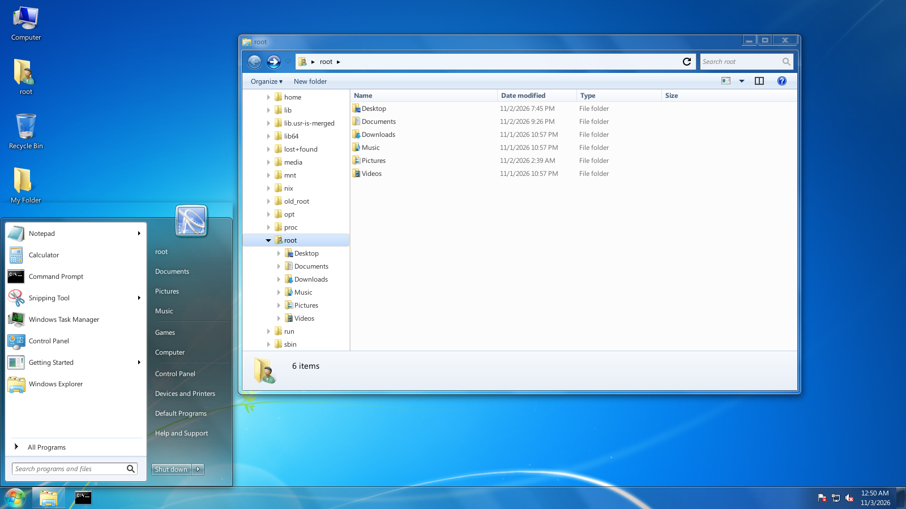
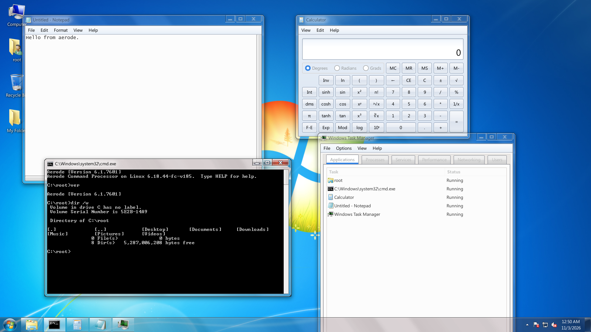
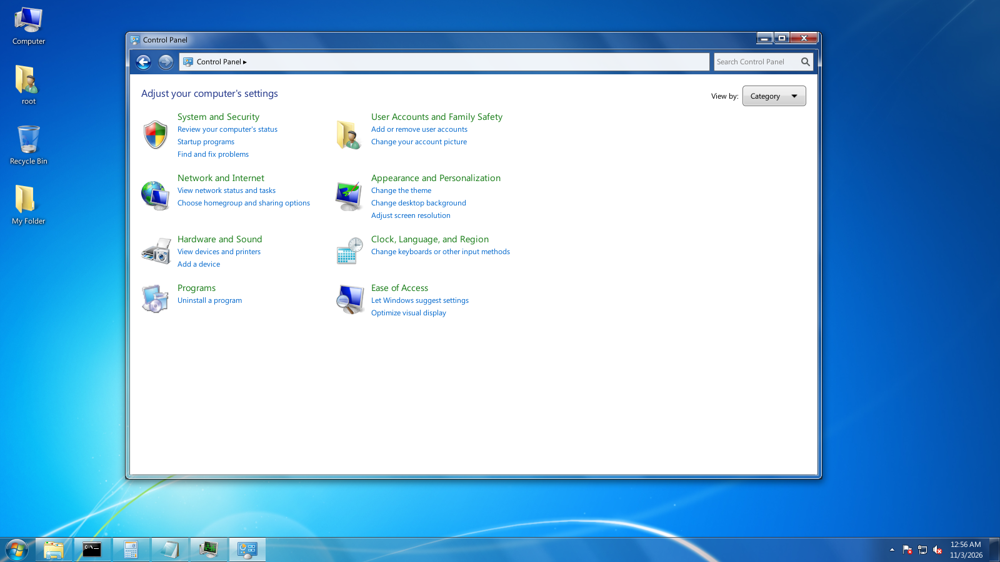

aerode

A Windows 7 desktop for Linux (X11), written in Rust. It aims to look and behave like the
Windows 7 shell as closely as possible while doing what a modern Linux desktop does.

What's in it

- aerode: desktop, taskbar, Start menu, notification area and flyouts
- aerode-wm: window manager with Aero glass frames, Snap, Shake, Peek and Alt+Tab
- Explorer, Control Panel, Notepad, Calculator, Task Manager, Snipping Tool, Command Prompt
- Win7 sounds, lock screen, UAC-style polkit prompts, notification balloons

Install (Arch / EndeavourOS)

    ./install.sh /path/to/your/windows7.iso

The installer builds aerode, installs it and pulls the Windows 7 artwork, fonts, sounds and theme
out of your own ISO into your home directory. Nothing from Microsoft is shipped in this repository.
Then pick "Aerode" at the login screen.

Useful commands

    aerode restart        restart the window manager, shell and compositor without logging out
    aerode lock           lock the screen

Settings are in ~/.config/aerode, crash logs in ~/.cache/aerode.

Status

Personal project, X11 only for now (Wayland later). Expect rough edges.
